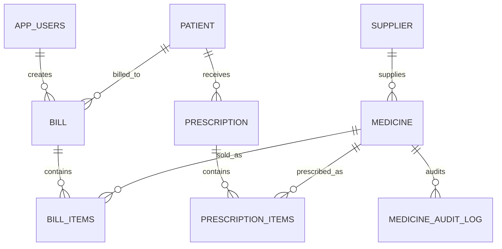

# RxCare — Hospital Pharmacy Management System
**VIT Chennai &bull; DBMS PAT 4 Comprehensive Application**  
**Technology Stack:** Python Flask, Oracle Database XE 21c (`XEPDB1`), Vanilla HTML5/CSS3/JavaScript, `python-oracledb` (Thin Mode)

---

## 🏥 Project Overview
**RxCare** is a full-stack, enterprise-grade healthcare pharmacy web application designed for Metropolitan Hospital. Engineered for the VIT Chennai DBMS PAT 4 project, the application demonstrates rigorous relational database engineering, ACID transaction controls, role-based access control, and intuitive healthcare user experiences tailored across three user groups:

1. **Public Visitors & Patients:** A welcoming public homepage (`/`), searchable hospital formulary catalog (`/medicines/catalog`), prescription status tracker (`/patient/lookup`), medication safety guide (`/prescriptions/guide`), clinical services directory (`/services`), institutional background (`/about`), and counter directory (`/contact`).
2. **Clinical Pharmacists:** A secure workspace (`/dashboard`) with real-time inventory management, stock alerts, patient profiles, multi-item atomic billing with pessimistic row locking (`SELECT ... FOR UPDATE`), and expiration monitoring.
3. **Hospital Administrators:** Privileged controls including staff account provisioning (`/users`), system-wide sales intelligence, inventory valuation, and database audit logs.

Every feature interacts directly with an **Oracle Database XE 21c pluggable database (`XEPDB1`)** via parameterized queries using the official `python-oracledb` driver. No SQLite, mock data, or fake database substitutes are used.

---

## 🌟 Key Functional Capabilities

### 🌐 1. Public Healthcare Portal
- **Welcoming Healthcare Homepage (`/`):** Features the "Your Health, Our Priority" mission, therapeutic formulary metrics, patient safety pledge, 4-step dispensing flow, and emergency contact details.
- **Searchable Medicine Formulary (`/medicines/catalog`):** Real-time public lookup by medicine name or therapeutic category. Displays patient retail pricing and friendly stock badges (*In Stock*, *Limited Availability*, *Consult Pharmacist*) without exposing internal supplier contracts, purchase costs, or warehouse batch codes.
- **Prescription Status Verification (`/patient/lookup`):** Enables patients and family members to verify prescription readiness using their numeric Prescription ID or registered phone number (supports exact, partial, or formatted numbers). Displays prescribing physician, issued medications, and counter collection instructions.
- **Educational Prescription Guide (`/prescriptions/guide`):** Clarifies Latin medical abbreviations (OD, BD, TDS, QID, SOS, AC, PC), safe temperature storage (2°C–8°C cold chain vs. room temp), antibiotic stewardship, and hospital medicine take-back bin procedures.
- **Pharmacy Services Directory (`/services`):** Details inpatient unit-dose dispensing, outpatient counters, 24/7 trauma formulary, medication counseling, cold-chain bio-storage, and formulary governance.
- **Institutional Contact & Hours (`/contact`):** Displays authentic Metropolitan Hospital Pharmacy location, hours, direct telephone lines (`+91 44 3993 1555`), and email (`pharmacy@metropolitanhospital.org`).

### 💊 2. Pharmacist Workspace
- **Formulary & Inventory Management (`/medicines/`):** Full CRUD operations for medicines, pharmacological category filters, batch tracking, unit prices, reorder thresholds, expiry date warnings, and referential integrity protection against deleting drugs referenced by past sales.
- **Point of Sale (POS) Billing Counter (`/billing/new`):**
  - Multi-item checkout supporting walk-in counter sales or registered hospital patients.
  - Live drug price and physical stock lookups via asynchronous JSON API (`/billing/api/medicine/<id>`).
  - **Pessimistic Row Locking (`SELECT ... FOR UPDATE`):** Protects stock integrity and eliminates race conditions.
  - **Atomic Transaction Management:** Atomically reduces stock and creates bill headers and items, rolling back on insufficient inventory or expired drugs.
  - **Printable Tax Invoice (`/billing/invoice/<id>`):** Clean, hospital-grade receipts with line-item breakdowns, discounts, and GST.
- **Patient Clinical Registry (`/patients/`):** Patient files with full consultation prescription history and billing receipts.
- **Clinical Prescriptions (`/prescriptions/`):** Multi-drug prescription orders linking patients, attending physicians, diagnoses, and dosage instructions.
- **Pharmaceutical Distributors (`/suppliers/`):** Full supplier registry and viewable supplier product catalogs.

### 🛡️ 3. Administrator Portal
- **Staff Account Governance (`/users`):** Provision and toggle active status for pharmacist and administrator user accounts, secured with PBKDF2 cryptographic hashing.
- **Sales Intelligence Reports (`/reports/sales`):** Date-filtered revenue reports, payment method distributions, and top-selling drugs.
- **Inventory Valuation (`/reports/inventory`):** Comprehensive asset valuation backed by Oracle views.
- **Expiry Risk Alerts (`/reports/expiry`):** Color-coded countdown badges for expired and near-expiry medications with supplier return links.
- **Data Exporting (`/reports/export/sales.csv`):** Standard CSV downloads for external audit review.

---

## 🎨 Design System & Branding
- **Brand Identity:** **RxCare** — featuring an original local SVG logo (`static/images/rxcare-logo.svg`) and high-resolution capsule/cross mark (`static/images/rxcare-icon.svg`).
- **Color Palette:** Formal medical institutional palette:
  - Deep Navy Blue (`#0f2b5c`, `#1b2a4a`)
  - Vibrant Medical Cyan & Teal (`#0284c7`, `#0d9488`, `#38bdf8`)
  - Clean Slate Background (`#f8fafc`)
  - Semantic Status Colors (Green `#15803d`, Amber `#b45309`, Crimson `#b91c1c`)
- **Typography & Accessibility:** Readable, accessible typography with clear contrast, subtle borders, responsive tables, accessible forms, keyboard-navigable interactive states (`:focus-visible`, outline rings), outline button system (`.btn-outline-primary`, `.btn-outline-secondary`), and mobile hamburger navigation.

---

## 📋 System Requirements (Windows)
1. **Operating System:** Windows 10 or Windows 11 (64-bit)
2. **Oracle Database:** Oracle Database Express Edition 21c (XE 21c) with pluggable database `XEPDB1`
3. **Command Line Tools:** Oracle `sqlplus.exe` and `lsnrctl.exe`
4. **Python:** Python 3.10+ (tested and verified on Python 3.14)
5. **Web Browser:** Google Chrome, Microsoft Edge, or Mozilla Firefox

---

## 🚀 Quick Start Guide (Windows)

All commands below should be executed from the root project directory:
```powershell
cd c:\Users\Keerthana\Desktop\HospitalPharmacyDBMS
```

### Step 1: Virtual Environment Setup
```powershell
# Create virtual environment if not already created
python -m venv venv

# Activate virtual environment
.\venv\Scripts\Activate.ps1

# Install dependencies
pip install -r requirements.txt
```

---

### Step 2: Oracle Database Verification & Provisioning

#### 2.1 Verify Oracle Services & Listener
```powershell
Get-Service *Oracle*
lsnrctl status
```
Confirm that `Service "xepdb1"` is listed with status `READY`.

#### 2.2 Provision Dedicated Application User (`setup_user.sql`)
Run SQL*Plus with SYSDBA privileges:
```powershell
sqlplus "/ as sysdba" @"setup_user.sql"
```
*Switches to container `XEPDB1`, creates `pharmacy_user` with password `YOUR_DB_PASSWORD`, and grants appropriate privileges.*

#### 2.3 Execute Schema & Seed Data
```powershell
# 1. Create tables, constraints, indexes, views, and audit triggers
sqlplus pharmacy_user/YOUR_DB_PASSWORD@localhost:1521/xepdb1 @"schema.sql"

# 2. Insert realistic clinical seed records
sqlplus pharmacy_user/YOUR_DB_PASSWORD@localhost:1521/xepdb1 @"seed_data.sql"
```

#### 2.4 Initialize Staff Accounts
```powershell
python init_admin.py
```
**Staff Login:** Staff members must use authorized accounts configured by the system administrator. Change any default or demo credentials before deployment. Never publish real passwords.

---

### Step 3: Run the Application
```powershell
python app.py
```
Open your browser and navigate to:
- **Public Homepage:** [http://127.0.0.1:5000/](http://127.0.0.1:5000/)
- **Formulary Catalog:** [http://127.0.0.1:5000/medicines/catalog](http://127.0.0.1:5000/medicines/catalog)
- **Track Prescription:** [http://127.0.0.1:5000/patient/lookup](http://127.0.0.1:5000/patient/lookup)
- **Staff Sign In:** [http://127.0.0.1:5000/login](http://127.0.0.1:5000/login)
- **Clinical Dashboard:** [http://127.0.0.1:5000/dashboard](http://127.0.0.1:5000/dashboard)

---

## 🧪 Automated Test Suite (28 / 28 Passing)

The project includes a comprehensive end-to-end test suite in `test_app.py` validating security, public endpoints, atomic database transactions, stock deduction, and role authorization:

```powershell
.\venv\Scripts\python.exe -m unittest test_app.py -v
```

### Verified Test Cases:
| Test ID | Test Description | Status |
|---|---|---|
| `test_01` | Unauthenticated user accessing protected `/dashboard` redirected to `/login` | ✅ Passed |
| `test_02` | Invalid credentials rejected with appropriate error notice | ✅ Passed |
| `test_03` | Admin login successfully authenticates and establishes session | ✅ Passed |
| `test_04` | Dashboard queries live metrics from Oracle XE 21c (`XEPDB1`) | ✅ Passed |
| `test_05` | Medicine inventory listing and live JSON API pricing endpoint | ✅ Passed |
| `test_06` | Atomic billing transaction reduces stock in Oracle with row locking | ✅ Passed |
| `test_07` | Insufficient inventory attempt rejected and rolled back cleanly | ✅ Passed |
| `test_08` | Sales reports, inventory valuation, and CSV file export | ✅ Passed |
| `test_09` | Pharmacist role restricted from administrative `/users` management | ✅ Passed |
| `test_10` | Public homepage accessible at `/` without authentication | ✅ Passed |
| `test_11` | Public formulary catalog accessible at `/medicines/catalog` | ✅ Passed |
| `test_12` | Public catalog search returns filtered results from Oracle | ✅ Passed |
| `test_13` | Prescription education guide accessible at `/prescriptions/guide` | ✅ Passed |
| `test_14` | Patient prescription verification page accessible at `/patient/lookup` | ✅ Passed |
| `test_15` | Patient prescription lookup returns doctor regimen for valid prescription | ✅ Passed |
| `test_16` | Public About and Services pages accessible without authentication | ✅ Passed |
| `test_17` | Contact page displays authentic Metropolitan Hospital Pharmacy details | ✅ Passed |
| `test_18` | Dashboard remains protected by `@login_required` following redesign | ✅ Passed |
| `test_19` | Login portal renders RxCare branding and return-to-home navigation | ✅ Passed |
| `test_20` | Public catalog filters by therapeutic category | ✅ Passed |
| `test_21` | Public catalog search for non-existent drug shows clean empty state | ✅ Passed |
| `test_22` | Public catalog privacy check: does not leak warehouse thresholds or supplier IDs | ✅ Passed |
| `test_23` | Prescription lookup with empty query warns user gracefully | ✅ Passed |
| `test_24` | Prescription lookup with non-numeric Rx ID rejects cleanly | ✅ Passed |
| `test_25` | Prescription lookup for non-existent ID displays empty state | ✅ Passed |
| `test_26` | Prescription lookup by patient phone finds active prescription records | ✅ Passed |
| `test_27` | Prescription lookup by unregistered phone displays empty state | ✅ Passed |
| `test_28` | Public visitors prevented from accessing internal staff operations | ✅ Passed |

---

## 🗄️ Oracle Database Schema Summary

The database architecture consists of 9 relational tables and 3 analytical views:



- **`APP_USERS`**: Staff credentials, roles (`ADMIN`, `PHARMACIST`), hashed passwords, activation status.
- **`SUPPLIER`**: Pharmaceutical distributor details, contact information, addresses.
- **`MEDICINE`**: Drug formulations, categories, unit prices, stock quantities, reorder thresholds, batch codes, expiry dates.
- **`PATIENT`**: Hospital patient demographics, age, gender, contact number, address.
- **`PRESCRIPTION`**: Clinical orders created by physicians for patients.
- **`PRESCRIPTION_ITEMS`**: Specific drugs, dosages, and quantities prescribed per order.
- **`BILL`**: Point-of-sale invoices, walk-in or patient billing, totals, taxes, discounts, payment methods.
- **`BILL_ITEMS`**: Serialized line items for each invoice with unit price and line totals.
- **`MEDICINE_AUDIT_LOG`**: Autonomous trigger-driven change log tracking stock updates.

---

## 🏛️ DBMS Laboratory PAT 4 Queries (`pat_queries.sql`)
The accompanying `pat_queries.sql` script provides 15 structured sections demonstrating all required syllabus concepts:
1. Table Creation with Primary & Foreign Keys (`CREATE TABLE`, `CHECK`, `REFERENCES`)
2. Data Manipulation Operations (`INSERT`, `UPDATE`, `DELETE`)
3. Data Retrieval & Expressions (`SELECT`, `NVL`, concatenation)
4. Relational & Logical Operators (`BETWEEN`, `IN`, `LIKE`, `AND`, `OR`)
5. Built-in SQL Functions (`UPPER`, `ROUND`, `MONTHS_BETWEEN`, `TRUNC`)
6. Aggregate Functions (`COUNT`, `SUM`, `AVG`, `MIN`, `MAX`)
7. Grouping & Filtering (`GROUP BY`, `HAVING`)
8. Multi-Table Relational Joins (`INNER JOIN`, `LEFT OUTER JOIN`)
9. Nested Subqueries (`IN`, `> ANY`, `> ALL`)
10. Correlated Subqueries & Set Existence (`EXISTS`, `NOT EXISTS`)
11. Analytical Database Views (`CREATE VIEW`)
12. Transaction Control Language (`COMMIT`, `SAVEPOINT`, `ROLLBACK`)
13. PL/SQL Anonymous Blocks & Explicit Cursors
14. Stored Procedures & Functions (`SP_PROCESS_MEDICINE_SALE`, `FN_CHECK_MEDICINE_EXPIRY`)
15. Database Triggers (`TRG_MEDICINE_STOCK_AUDIT`)

Execute via SQL*Plus:
```powershell
sqlplus pharmacy_user/YOUR_DB_PASSWORD@localhost:1521/xepdb1 @"pat_queries.sql"
```

---

## 🔒 Security Architecture
- **Password Protection:** Cryptographic PBKDF2 with SHA-256 and unique salt via `werkzeug.security`. Plaintext passwords are never stored.
- **SQL Injection Prevention:** 100% of queries use named bind parameters (`:param`).
- **CSRF Protection:** State-changing requests (`POST`) require matching session CSRF tokens.
- **Role Isolation:** `@admin_required` and `@login_required` route decorators enforce strict least-privilege access.
- **Public Data Privacy:** Public search endpoints sanitize clinical and financial data, hiding batch numbers, costs, supplier relationships, and margin analytics.

---

## 📄 License & Attribution
Developed for the **DBMS PAT 4 Laboratory Examination**, School of Computer Science and Engineering, **VIT Chennai**.  
All patient records and transactions are synthetic demonstration data.
